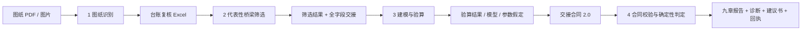

# 既有桥梁自动化抗震性能评估 Agent

面向既有公路梁桥的抗震评估流程源码仓库。项目把工作拆成四个可以独立运行、通过结构化数据交接的 Agent 组件：

```text
图纸识别 → 代表性桥梁筛选 → 参数化建模与 E1/E2 验算 → 报告、判定与决策建议
```

仓库统一保留了 Python 实现、Agent 知识库、数据合同、离线演示、工程报告工作台、示例案例和自动化测试。复核人员在本地工作台导入交接数据，即可检查合同、执行确定性判定、诊断薄弱环节并生成九章报告；没有 SAP2000 或外部大模型时，也可以使用 dry-run 与离线演示模式跑通流程。

> **工程声明：**本仓库输出均为评估工具成果，默认标记 `engineering_release=false`。地震参数、建模假定、验算结果和加固建议必须由具备相应资质的专业人员复核，不能直接作为设计、施工或养护签发文件。

## 组件

| 步骤 | 组件 | 版本 | 形态 | 入口 |
|---|---|---|---|---|
| 1 | 桥梁图纸智能识别 | 0.2.0 | Python Skill | [`skills/bridge-drawing-recognition/`](skills/bridge-drawing-recognition/) |
| 2 | 代表性桥梁筛选 | 1.2 | 知识型 Skill | [`skills/bridge-screening/`](skills/bridge-screening/) |
| 3 | 自动化抗震建模与验算 | 1.0 | Python Skill | [`skills/bridge-seismic-pipeline/`](skills/bridge-seismic-pipeline/) |
| 4 | 报告与决策 Agent | 3.3.0 | Python 应用 / Web 工作台 | [`bridge_report/`](bridge_report/) |

### 1. 图纸识别

将扫描版桥梁施工图 PDF/图片转成带页码、哈希、证据和置信度的字段候选，并输出 Excel 复核工作簿。核心实现不包含供应商 SDK、网络调用或密钥，视觉能力由宿主以 `module:factory` 注入。没有视觉后端时，仍可执行台账清点、归一化、页面清单和 dry-run。

### 2. 代表性桥梁筛选

按 15 条专家标准、整桥去重和动态覆盖规则选择代表性桥梁，输出筛选结果、说明文档和全字段交接表。该组件是面向 Agent 宿主的知识包，需要宿主具备读取 Excel、执行规则并写出文件的能力。

### 3. 建模与验算

把筛选表或参数 JSON 转成逐桥参数、SAP2000 建模指令与 E1/E2 简化验算结果。默认 dry-run 不连接 SAP2000，结果来自规范简化法；`--real` 可切换到本机 SAP2000 OAPI。所有假定参数、转换警告和 dry-run 属性都会随结果记录。

### 4. 报告与决策

对交接合同执行机器校验，由确定性规则引擎给出 `PASS / FAIL / PLASTIC / BLOCKED / SKIPPED / NA` 判定，再生成诊断、九章 DOCX/HTML 报告、建议书、质量自检和 SHA256 交付回执。LangChain + LangGraph Agent 只负责工具编排、解释与建议撰写，不能改写引擎结论；默认离线模式无需 API Key。

## 系统数据流



第 3 步到第 4 步的正式接口是 [`contracts/handoff.schema.json`](contracts/handoff.schema.json)。仓库提供两份可通过校验的工程案例和多个规则变体，用于复现报告链路。第 3 步当前的默认产出是简化验算结果；接入 SAP2000 真机或既有有限元成果时，应按交接合同整理 `handoff.json` 和图件后再进入第 4 步。

## 快速开始

### 环境

- Windows 10/11（SAP2000 OAPI 与 Word COM 仅在 Windows 可用）
- Python 3.12 或更新版本
- Microsoft Word 可选：用于刷新目录、导出 PDF 和逐页预览
- SAP2000 V22 与 license 可选：仅在真机建模模式需要

### 安装与验证

```powershell
python -m venv .venv
.\.venv\Scripts\python.exe -m pip install -r requirements.lock.txt
.\.venv\Scripts\python.exe -m pip install -r requirements-pipeline.txt
.\.venv\Scripts\python.exe -m unittest discover -v
```

也可以运行统一脚本：

```powershell
.\scripts\setup.ps1
.\scripts\verify.ps1
```

### 启动报告工作台

```powershell
.\Start-Demo.ps1
```

浏览器打开 <http://127.0.0.1:8766>。默认选择“离线演示”，不需要 API Key。运行记录与成果保存在 `build/workbench/`。

### 运行图纸识别

```powershell
$env:PYTHONPATH = Join-Path $PWD 'skills\bridge-drawing-recognition\scripts'
.\.venv\Scripts\python.exe -m bridge_drawing_agent.cli doctor
.\.venv\Scripts\python.exe -m bridge_drawing_agent.cli manifest `
  "D:\drawings" --output "build\manifest" --render-thumbnails
```

需要实际调用视觉模型时，显式注入后端：

```powershell
.\.venv\Scripts\python.exe -m bridge_drawing_agent.cli `
  --backend your_module:factory extract-manifest `
  "build\manifest_classified.json" --output "build\fields.json"
```

后端契约见 [`skills/bridge-drawing-recognition/references/vision-backend-contract.md`](skills/bridge-drawing-recognition/references/vision-backend-contract.md)。

### 运行抗震建模与验算

```powershell
.\.venv\Scripts\python.exe skills\bridge-seismic-pipeline\scripts\run_pipeline.py `
  skills\bridge-seismic-pipeline\scripts\bridge_modeler `
  --outdir build\pipeline-demo --select K44+430
```

真机模式需先按 [`skills/bridge-seismic-pipeline/references/check_method.md`](skills/bridge-seismic-pipeline/references/check_method.md) 的清单核对 OAPI 签名，再加上 `--real`。没有 SAP2000 时不要将 dry-run 数值表述为有限元结果。

### 运行报告 CLI

```powershell
.\.venv\Scripts\python.exe -m bridge_report.agent.runtime `
  examples\golden\76K278+308\handoff.json `
  --out build\cli-demo --root examples
```

输出目录需为空。工作台和 CLI 都默认生成 `report.docx`、`report.html`、`result.json`、`diagnosis.json`、`qa.json`、`input.json` 和 `receipt.json` 等交付文件。

## 仓库结构

```text
.
├─ bridge_report/            第 4 步：合同、判定、Agent、报告、服务
├─ contracts/                交接合同 2.0、字段字典和填报模板
├─ skills/
│  ├─ bridge-drawing-recognition/
│  ├─ bridge-screening/
│  └─ bridge-seismic-pipeline/
├─ static/                   本地工作台前端
├─ templates/                Word 母版与参考报告
├─ examples/                 金标准案例、规则变体和三维预览
├─ tests/                    第 4 步自动化回归测试
├─ tools/                    提取、金标准对照、维护和界面检查工具
├─ docs/                     系统说明、申报材料、交接规范与演示视频
├─ requirements.lock.txt     第 4 步锁定依赖
└─ requirements-pipeline.txt 第 3 步 dry-run 依赖
```

## 验证状态与边界

- 报告应用包含 157 个 `unittest` 用例，覆盖合同校验、判定规则、报告构建、Agent 工具链、服务接口和协议适配；Word 专项测试按环境变量跳过。
- 第 1、3 步已通过语法编译和 dry-run 冒烟检查；第 3 步真机 OAPI 仍需在安装 SAP2000 的机器上按清单验证。
- 第 2 步是知识型 Skill，不包含独立的评分程序；运行结果取决于宿主 Agent 对 Excel 的读取和写入能力。
- `templates/reference/` 中的参考报告、旧版 Word 母版和由实桥资料提取的示例数据仅用于格式复现与流程验证，不随项目代码授予新的再分发许可。公开仓库前请确认数据与参考报告的发布范围。
- 本仓库不包含 API Key。真实模型密钥仅保存在本地服务进程内存中。

更完整的架构、接口和工程约束见：

- [系统技术说明](docs/系统技术说明.md)
- [第 3→4 步数据交接说明](docs/第三步数据交接说明.md)
- [报告撰写规范](docs/报告撰写规范.md)
- [维护说明](docs/维护说明.md)
- [组件与数据流说明](docs/组件与数据流.md)
- [演示视频索引](docs/media/README.md)

## 许可与引用

本仓库目前未附加统一的开源许可证。代码、工程模板、参考报告和示例数据的权利归属与再分发范围不同，发布前应确认团队和来源单位授权。第三方依赖及其许可证见 [`THIRD_PARTY_NOTICES.md`](THIRD_PARTY_NOTICES.md) 和 [`NOTICE.md`](NOTICE.md)。
