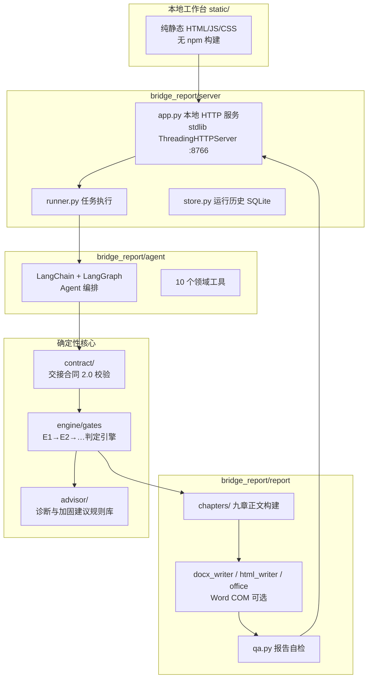

# 既有桥梁自动化抗震性能评估 Agent — 技术说明文档

| 文档信息 | 内容 |
|---|---|
| 项目名称 | 既有桥梁自动化抗震性能评估 Agent 开发 |
| 文档版本 | v1.0 |
| 编写日期 | 2026-10-17 |
| 适用读者 | 团队开发成员、维护人员、评审专家 |
| 对应实现 | 统一源码仓库：`skills/bridge-drawing-recognition`（v0.2.0）· `skills/bridge-screening`（v1.2）· `skills/bridge-seismic-pipeline`（v1.0）· `bridge_report`（v3.3.0） |

---

## 1. 项目概述与目标

### 1.1 项目背景

我国大量既有公路桥梁按旧规范（JTJ 004-89、JTJ 023-85 等）设计，抗震设防水准偏低。随着《中国地震动参数区划图》（GB 18306-2015）更新和《公路桥梁抗震设计规范》（JTG/T 2231-01—2020）的实施，既有桥梁亟需系统开展抗震评估。当前人工评估工作存在四大痛点：

1. **图纸资料非结构化**：900+ 套桥梁图纸、200 GB+ 扫描件，人工逐座提取特征耗时耗力；
2. **代表性桥梁选择无标准流程**：筛选依赖专家经验，效率低、结论难复现；
3. **有限元建模复杂**：人工建立 SAP2000 精细模型周期长、计算成本高；
4. **工程报告撰写繁杂**：单份报告约 40 页、数十张验算表，数值复制、措辞统一与排版占去工程师大量时间，且数据分散在 PDF、模型和十余个 Excel 中，结论难追溯。

### 1.2 项目目标

构建一条 **"图纸识别 → 典型桥筛选 → 抗震建模验算 → 报告与决策"** 的全流程自动化评估链路，由 4 个可独立运行、通过标准数据契约串联的 Subagent 组成，运行于 WorkBuddy / Claude 类 Agent 宿主环境：

- 将图纸特征提取由人工筛选变为 LLM/OCR 辅助自动识别，形成结构化数据库；
- 将专家筛选经验沉淀为可版本化、可复现的 Skill 规则库（15 条标准、权重 100%）;
- 将 SAP2000 参数化建模 + E1/E2 抗震验算压缩为"一条命令"的批量流水线；
- 将 40 页工程报告的编制缩短为分钟级自动生成 + 人工复核。

**核心设计原则**：*确定性引擎定结论，大模型做组织与建议*。凡涉及工程数值与合规判定，均由代码化的规则引擎产生；LLM 只负责调度、解释与文字撰写，且其输出受数值溯源校验约束。所有成果默认标注 `engineering_release=false`，须经专业人员复核后方可签发。

---

## 2. 整体架构设计

### 2.1 总体数据流

四个 Subagent 按"接力"方式串联，每个环节的输出即下一环节的输入，接口契约明确：

```mermaid
flowchart LR
    A[扫描图纸 PDF/图片<br/>900+ 套] --> B["Subagent1 图纸智能识别<br/>bridge-drawing-recognition"]
    B --> C1[桥梁台账复核 Excel<br/>筛选结果/字段证据/元数据]
    C1 --> D["Subagent2 典型桥筛选<br/>bridge-screening v1.2"]
    D --> C2[筛选结果/筛选说明/<br/>入选桥梁全字段 Excel]
    C2 --> E["Subagent3 抗震建模与验算<br/>bridge-seismic-pipeline"]
    E --> C3[参数 JSON + SAP2000 模型<br/>E1/E2 验算结果 JSON/MD]
    C3 --> F["Subagent4 报告与决策 Agent<br/>bridge_report"]
    F --> C4[九章报告 DOCX/HTML/PDF<br/>建议书/诊断/回执 等 9 项交付物]
```



### 2.2 分层架构

每个 Subagent 内部遵循相似的分层模式：**知识/规则层（Skill 文档 + 规则库）→ 确定性执行层（Python 代码）→ 契约层（JSON Schema / Excel 字段字典）→ 交付层（Excel / JSON / DOCX / MD）**。

以 Subagent4 为例的模块划分（其余 Subagent 同理，规模较小）：



### 2.3 关键架构决策

| 决策 | 说明 |
|---|---|
| **契约先行** | 相邻 Subagent 间以 JSON Schema / 字段字典为接口契约（如"交接合同 2.0"），各环节可并行开发、独立替换 |
| **能力注入而非内置** | 图纸识别的视觉能力（`analyze_image` 后端）、报告撰写的 LLM 服务均由宿主环境注入，Skill 仓库不包含 SDK、密钥与网络调用 |
| **Dry-run 与真机双模** | 无 SAP2000 的机器上以 dry-run 记录 OAPI 指令序列 + 规范简化法验算，跑通全流程；有 SAP2000 时 `--real` 切换真机模式，输出格式不变 |
| **证据可追溯** | 每个数值记录来源（Excel 源行、图纸证据、SHA256 文件哈希），交付带 `receipt.json` 回执 |
| **AI 有边界** | 模型不能改写引擎判定结果；建议书数值自动核对出处；交接包内的文字不作为指令执行（防注入） |

---

## 3. 核心模块及功能说明

### 3.1 Subagent1 — 桥梁图纸智能识别（bridge-drawing-recognition v0.2.0）

**职责**：将扫描版中文桥梁施工图 PDF/图片处理为"有证据支撑"的桥梁字段记录与 Excel 复核工作簿。只做确定性图纸处理，不虚构缺失值、不充当结构设计权威。

**模块组成**（`scripts/bridge_drawing_agent/`）：

| 模块 | 功能 |
|---|---|
| `pdfium.py` | PDF 渲染、页面哈希、尺寸与缩略图生成（pypdfium2，可自动发现宿主 PDFium DLL） |
| `manifest.py` | 构建页面清单（页码、哈希、尺寸、缩略图路径） |
| `vision.py` | 视觉后端加载器（`module:factory` 注入）、`CallableVisionBackend`、`VisionResponse` |
| `extraction.py` / `normalization.py` | 按页面类型抽取字段、候选合并（按证据与置信度，冲突保留）、数值归一化 |
| `workbook.py` / `xlsx_writer.py` / `exporter.py` | 读取台账 Excel（忽略 A 列）、输出 `筛选结果`、`字段证据`、`可选墩高`、`问题`、`元数据` 五张工作表 |
| `pipeline.py` / `cli.py` | 全流程编排与命令行入口 |

**工作流**：台账清点 → 台账归一 → 页面清单 → 后端页面分类 → 仅对相关页型抽取相关字段 → 按证据/置信度合并候选 → 导出五表 → 未核实值标记待复核，**绝不静默回填**。

**字段字典**：`assets/field_dictionary.csv` 定义 A–AB+ 共 28 类字段（序号、设计桩号、左右幅、跨径、桥跨组合、主梁形式、结构形式、支座、桥台、桥墩形式/尺寸、纵横墩高差、桩基、盖梁/桥墩/系梁/桩配筋率、逐墩墩高等），并规定各字段的主要图纸证据来源。

### 3.2 Subagent2 — 基于专家经验的典型桥梁筛选（bridge-screening v1.2）

**职责**：读取公路梁桥 Excel 台账，按 15 项专家标准动态评分选桥，输出筛选结果 Excel、说明文档 MD 和入选桥梁**全字段**结构化交接 Excel。本 Subagent 为**纯知识型 Skill**（无代码），由规则文档驱动宿主 Agent 执行。

**知识库**（`references/`）：

| 文件 | 内容 |
|---|---|
| `筛选标准_15条.md` | 唯一评分依据：S01–S15 共 15 条标准，权重合计 100%（P0 结构/墩型/基础/墩高差/高墩/大跨/支座合计 72%，P1 占 22%，P2 占 6%）；C 类覆盖分（2/1/0 随入选集合动态衰减）与 D 类参数关注分（Q25/Q75 分位插值）两种评分法；L/H 分数区间与信息覆盖率计算 |
| `输出要求.md` | 四张必备工作表（逐桥评分/入选名单/入选原因/评分明细）的字段、30 字原因简述规则、说明 MD 的 7 节结构 |
| `全字段交接要求.md` | 多行记录、合并单元格、公式文本、无表头列的处理规则："一行对应一个源物理行"宽表 + 字段字典 + 单元格溯源表 |
| `专家skill编写_原始.md` | 专家原始资料，按 N/M/W/H 四类来源索引，供争议查证 |

**关键业务规则**：
- **整桥与建模单元**：同桥上下行、不同联可有多个建模单元，只占一个名额；各单元独立评分，整桥首轮分取最高单元；选中后移除该整桥全部单元防止重复；不得拼装"虚拟桥"；
- **动态覆盖选桥**：确定目标数量 N 后逐轮选择，每轮按 L 排序、同分按标准打破；完成后做结构体系与低/高墩覆盖审计并补换；
- **诚实性约束**：身份待核不计入数量；足额候选不存在时报告缺口，不编造对象；评分低 ≠ 不安全。

### 3.3 Subagent3 — 自动化抗震建模与验算（bridge-seismic-pipeline v1.0）

**职责**：把 Subagent2 的筛选表一键转换为每桥参数 JSON、SAP2000 建模产物、E1/E2 抗震验算结论与演示动画。

**模块组成**（`scripts/`）：

| 模块 | 功能 |
|---|---|
| `xlsx_to_params.py` | 筛选表 → 参数 JSON（G8511 格式适配，含转换警告与假定值声明，汇总到 `_conversion_summary.json`） |
| `bridge_modeler/builder.py` | 脊梁式单主梁参数化建模：等效 General 截面脊梁（节点距 2 m）、盖梁+双柱/单柱墩+桩基（8 段）、m 法桩土弹簧（K = m·d·Δz）、支座 Link 单元 |
| `bridge_modeler/sap_driver.py` | SAP2000 OAPI 驱动（comtypes）；dry-run 模式输出 `*_oapi_log.jsonl` 指令序列 |
| `bridge_modeler/spectrum.py` | JTG/T 2231-01—2020 反应谱：`Smax = 2.25·Ci·Cs·Cd·A`，三段式曲线，SAP 中以 `FuncRS.SetUser` 离散点输入，模态 30 阶（质量参与 ≥90%） |
| `bridge_modeler/check.py` | 无 SAP2000 时的规范简化法验算：等效悬臂刚度 k = n·3EI/(H+1.5)³ → 周期 T → E1 强度（F=S·W，与 2% 配筋率假定截面能力比较）→ E2 位移（δd 与 δy·μΔ 比较），逐墩给出 E1/E2 通过/不通过 + 安全系数 |
| `bridge_modeler/animate_model.py` | matplotlib + imageio 渲染建模生长动画 MP4 |
| `run_pipeline.py` | 一条命令批量流程，支持 `--select`（单桥）、`--animate`、`--real`（真机）、`--ag/--site/--tg`（设防参数覆盖） |

**五条关键规则**：假定值必须随结果声明（JSON `_note`/`_warnings`）；验算"不通过"是有效产出，不得调参凑通过；dry-run 产物 ≠ 有限元结果，对外表述必须说明；不支持的桥型（拱/斜拉/悬索、墩尺寸缺失）自动跳过并记录；改 Schema/验算方法前必读对应 reference 文档。

### 3.4 Subagent4 — 工程报告撰写与决策 Agent（bridge_report v3.3.0）

**职责**：接收第三步交接包，完成合同检查 → 确定性判定 → 薄弱环节诊断 → 九章报告生成 → 建议书撰写 → 质量自检 → 交付回执。

**模块组成**（`bridge_report/`）：

| 模块 | 功能 |
|---|---|
| `contract/` | 交接合同 2.0 解析与机器校验（`handoff.schema.json`）；ZIP 路径安全校验（拒绝 `..`、绝对路径、符号链接） |
| `engine/gates.py` | **确定性判定引擎**：按 E1 → E2 桥墩屈服 → 桩基能力保护 → 墩桩抗剪 → 支座/承台/构造 → 延性三项 → 加固复核流程判定；状态机区分 `PASS / FAIL / PLASTIC / BLOCKED / SKIPPED / NA`；中断规则仅 E1、桩基屈服、墩桩抗剪三类 |
| `engine/rules.py` / `terms.py` | 判定规则与措辞表（如"进入塑性"≠"不通过"） |
| `advisor/` | 薄弱环节诊断（失效模式归类、控制项、最小裕度、加固前后变化）+ 9 类加固措施定性规则库 |
| `agent/` | LangChain + LangGraph Agent，固定工具链 10 个工具 + 按需只读 `query_checks`；支持 OpenAI Chat Completions / OpenAI Responses / Claude Messages 三种协议；离线演示模式无需 API Key |
| `report/` | 九章正文构建（`chapters/ch1–ch9`）、DOCX/HTML 渲染、公式 OMML、图表、Word 母版模板管理（占位符校验）、Word COM 可选导出 PDF 与逐页预览、`qa.py` 自检 |
| `server/` | 本地工作台 HTTP 服务（`http://127.0.0.1:8766`），任务执行、运行历史（SQLite）、场景与合同 API |
| `pipeline.py` | judge → compose → render → check → deliver 共享流水线 |

**Agent 固定工具链**：

```
inspect_handoff → read_report_rules → evaluate_gates → diagnose_weaknesses
→ compose_report → render_documents → run_quality_checks
→ write_advisory_memo → finalize_delivery
```

工具间设前置条件（未验算不能诊断、未诊断不能写建议书…），防止模型跳步。`write_advisory_memo` 会核对建议书中每个数值能否在验算结果中找到出处，无法匹配的自动标注退回。

**六个任务场景**：加固方案比选、加固效果复核、下一步工作安排、业主汇报简报、安全裕度体检、专家审查意见——同一判定数据按角色生成不同建议书。

**交付物（9 个文件）**：`report.docx/pdf/html`、`advice.md`、`diagnosis.json`、`result.json`、`qa.json`、`input.json`（输入快照）、`receipt.json`（文件清单 + SHA256，`engineering_release=false`）。

---

## 4. 技术选型及理由

| 类别 | 选型 | 理由 |
|---|---|---|
| 开发语言 | **Python 3.12+**（各 Subagent 均为 Python） | 生态成熟：PDF/Excel/科学计算/COM 调用均有现成库；团队统一技术栈 |
| PDF 渲染 | **pypdfium2**（Subagent1）、**PyMuPDF**（Subagent3/4 辅助） | 便携、免安装依赖的 PDFium 绑定，适合批量扫描图纸栅格化 |
| OCR / 视觉 | **LLM 视觉后端注入**（`analyze_image` 契约）+ Windows OCR 兜底（Subagent4 图纸预览） | 专业性强、精度要求高的图纸理解交给多模态大模型；能力与 Skill 解耦，可换云端/本地模型，仓库不含密钥 |
| Agent 框架 | **LangChain + LangGraph**（Subagent4） | 工具循环编排成熟，`langgraph-checkpoint-sqlite` 提供检查点追溯；支持多协议模型接入 |
| 有限元驱动 | **SAP2000 OAPI（comtypes）** | 桥梁抗震行业主流工具；OAPI 实现参数化建模；dry-run 模式保证无 license 环境可开发演示 |
| 报告渲染 | **python-docx + lxml（OMML 公式）+ Word COM（可选）** | 按实验室 Word 母版生成九章报告，自动编号/交叉引用；有 Word 时刷新目录导 PDF，无 Word 仍出 DOCX/HTML |
| 表格处理 | **openpyxl**（读写 Excel）、宽表无合并单元格设计 | 保留多行记录与单元格溯源，避免合并单元格破坏数据结构 |
| 前端 | **纯静态 HTML/JS/CSS（无 npm 构建）** | 内网部署零构建链，降低维护门槛 |
| 本地服务 | **Python 标准库 `ThreadingHTTPServer`** | 单文件依赖、离线可运行，符合工程数据不出内网的要求 |
| 数值计算 | **numpy / matplotlib / imageio(-ffmpeg)** | 简化法验算、反应谱曲线、建模动画 |
| 数据校验 | **jsonschema + Pydantic** | 交接合同机器校验 |
| 测试 | **unittest discover（157 项自动化测试）** | 每条判定规则配测试，"不通过即不采纳"；金标准报告对照（`tools/compare_golden.py`） |

**规范依据**（判定规则与报告体系）：JTG/T 2231-01—2020（主）、JTG 3362-2018、JTG 3363-2019、GB 18306-2015，并保留原设计规范材料换算（如 30 号混凝土 ≈ C28，抗压设计值 13.04 MPa）。

---

## 5. 数据结构与接口定义

### 5.1 接口契约总览

| 边界 | 接口 | 载体 |
|---|---|---|
| 宿主 → Subagent1 | 视觉后端 `module:factory` | Python 工厂函数，返回实现 `analyze_image(...)` 的对象 |
| Subagent1 → Subagent2 | 台账复核工作簿 | Excel（筛选结果/字段证据/可选墩高/问题/元数据五表） |
| Subagent2 → Subagent3 | 筛选结果表 + 全字段交接 Excel | Excel（G8511 筛选结果格式） |
| Subagent3 → Subagent4 | 参数 JSON → 建模验算结果 → 交接合同 | `handoff.json`（+ `assets/` 图件 ZIP，≤50 MB） |
| Subagent4 内部 | 交接合同 2.0 Schema | `contracts/handoff.schema.json`（机器校验）+ `handoff.template.json`（填报模板） |

### 5.2 视觉后端契约（Subagent1）

```python
def analyze_image(
    image: str | bytes,          # 图片路径或编码字节
    prompt: str,
    *,
    system_prompt: str | None = None,
    json_schema: dict | None = None,
    detail: str = "high",
    image_mime_type: str | None = None,
) -> dict | list | str | VisionResponse: ...
```

- 通过 `--backend your_module:factory` 或环境变量 `BRIDGE_VISION_BACKEND=your_module:factory` 注册；
- 要求：尽量返回解析后的 JSON；需保留原始文本/模型名/用量时返回 `VisionResponse`；供应商失败抛明确异常；**仓库内不得出现凭据或供应商专属代码**；
- 无后端时仅允许运行清点、归一化、清单、Schema 检查和 dry-run 命令，禁止伪造抽取结果。

### 5.3 桥梁参数 JSON Schema（Subagent2 → Subagent3 契约）

单位体系：m / kN / t / MPa。

```jsonc
{
  "bridge_name": "…(含左右幅/上下行)",
  "stake": "K257+528",
  "source_drawing": "溯源信息",
  "spans": [{"length": 30}],               // 长度 = 跨数
  "piers": [{                              // 长度 = 跨数-1
    "pier_id": "P1",
    "location": 30.0,                      // 距起点 x 坐标 m
    "height": 12.0,                        // 缺失时全桥均值补齐并记 warning
    "n_columns": 2,
    "column_diameter": 1.4,                // 矩形墩按 φ=√(4ab/π) 等效并记 warning
    "column_spacing": 6.0,                 // 假定值
    "cap_beam_height": 1.5, "cap_beam_width": null,
    "pile_diameter": null, "pile_length": 25.0,   // 假定值
    "soil_m": 10000                        // m 法比例系数（假定）
  }],
  "abutments": [{"location": 0, "type": null, "restraint": null}],
  "deck": {},                              // 主梁等效截面（空心板/T梁/箱梁三档预设）
  "materials": {"C30": {"fck": null, "elastic_mod": null}},
  "seismic": {"intensity": 7, "ag": 0.10, "site_class": "II", "tg": 0.45,
               "ci": null, "cs": null, "cd": null, "damping": null},
  "bearings": "支座形式（记录用）",
  "_note": "假定值声明", "_warnings": ["转换警告…"]
}
```

**必须随结果交付的已知假定值**：柱间距 6.0 m、桩长 25 m、主梁等效截面三档预设、设防参数（默认 7 度 0.10g、II 类、Tg=0.45 s）、m=10000 kN/m⁴、配筋率 2%。拱桥/斜拉/悬索桥型及墩尺寸缺失者跳过，记入 `_conversion_summary.json`。

### 5.4 交接合同 2.0（Subagent3 → Subagent4 契约）

- **交付形式**：ZIP（根目录 `handoff.json` + `assets/` 图件，`assets[].path` 相对路径，服务端拒绝 `..`/绝对路径/符号链接，上限 50 MB）或单个 JSON（图件以"图件待补充"占位）。
- **单位**：力 kN、弯矩 kN·m、位移 m、ratio 无量纲；轴力正压负拉，须在 `analysis.axial_sign` 声明。
- **字段组**（18 组，必交项含 `contract_version`/`data_kind`/`bridge_id`/`model_revision`、`project`、`analysis`（`converged=false` 不得判定）、`components`、`actions`（同工况成组内力 N/M）、`checks`、`detailing`、`assets`/`sources` 等；可选组含 `seismic`、`materials`、`model`/`modal`、`pilecap`、`retrofit`、`not_applicable` 等）。
- **验算记录 `checks[]` 的 kind 枚举**：

| kind | 构件 | 水准 | demand/capacity |
|---|---|---|---|
| `e1_capacity` | 墩、桩 | E1 | 最不利轴力 N / 截面承载力 Nu（kN），须 `paired_N_M`+`action_id` |
| `e2_moment` | 墩、桩 | E2 | 弯矩 / 等效屈服弯矩（kN·m） |
| `shear` | 墩、桩 | E2 | 剪力 / 抗剪能力（kN） |
| `bearing_displacement` | 支座 | E1/E2 | 位移 / 规范限值（m） |
| `bearing_sliding` | 支座 | E1/E2 | 需求 / 抗力（kN） |
| `hinge_shear` | 墩 | E2 | 剪力 / Vn（kN），`phi=0.9` |
| `ductility_displacement` | 墩 | E2 | 位移需求 / 容许位移（m） |
| `ductility_reinforcement` | 墩 | E2 | 最小/实配配箍率（ratio） |
| `measures` / `additional` | 措施/盖梁/系梁 | E1/E2 | 按验算内容 |

每条记录须有 `component`、`section_label`、`direction`、`level`、`unit`、`model_revision`、`evidence`；同一构件/方向/水准/类型仅一条；缺失填 `null` 判待补正。`overstrength`（超强复算）只检查依据、复核标志与证据，不自行套系数。

### 5.5 Subagent4 判定结果与交付数据结构

- `result.json`：逐项判定（状态 ∈ {PASS, FAIL, PLASTIC, BLOCKED, SKIPPED, NA}、需求/能力/比值、结论措辞）；
- `diagnosis.json`：失效模式归类、控制项、最小裕度、加固前后变化、候选措施与复算清单；
- `qa.json`：报告自检意见（缺项、编号、题注、引用、措辞）；
- `receipt.json`：总体状态、输入快照、文件清单及 SHA256、`engineering_release=false`。

---

## 6. 部署与运行环境要求

### 6.1 硬件与操作系统

- **操作系统**：Windows 10/11（Subagent3 的 SAP2000 OAPI 与 Subagent4 的 Word COM 依赖 Windows；Subagent1/2 的核心逻辑跨平台）
- **内存**：≥16 GB（批量 PDF 渲染与动画渲染建议 32 GB）
- **网络**：默认离线可运行（离线演示模式）；首次安装依赖及接入真实 LLM 时需联网

### 6.2 软件环境

| 组件 | 要求 | 说明 |
|---|---|---|
| Python | 3.12+（项目在 3.13/3.14 验证） | 建议 venv 隔离 |
| Subagent1 依赖 | `Pillow>=10.0`、`pypdfium2>=4.30` | 见 `scripts/requirements.txt` |
| Subagent3 依赖 | `pymupdf / rapidocr / matplotlib / imageio / imageio-ffmpeg / numpy / openpyxl` | dry-run 必需 |
| Subagent3 真机模式 | **SAP2000 V22**（license 可用）+ `comtypes` | 首次使用按 `references/check_method.md` 真机核对清单逐项确认 |
| Subagent4 依赖 | `requirements.lock.txt` 锁定（langchain/langgraph、python-docx、jsonschema、pydantic、pypdfium2、matplotlib、anthropic、openai 等） | 更新依赖后须重启工作台 |
| Microsoft Word | 可选 | 有则刷新目录、导出 PDF、逐页预览；无则仅出 DOCX/HTML |
| 视觉后端 | 可选 | Subagent1 抽取类命令需要；无后端限 dry-run 功能 |

### 6.3 启动方式

```powershell
# Subagent1（示例：页面清单 + 分类 + 抽取）
python -m bridge_drawing_agent.cli doctor
python -m bridge_drawing_agent.cli --backend your_module:factory extract-manifest ...

# Subagent3（从统一仓库根目录执行一条命令批量流程）
python skills/bridge-seismic-pipeline/scripts/run_pipeline.py 筛选表.xlsx --outdir <输出目录> [--select K257+528] [--animate] [--real] [--ag 0.10]

# Subagent4（本地工作台）
.\Start-Demo.ps1          # 或双击 启动演示.cmd
# 浏览器打开 http://127.0.0.1:8766，默认"离线演示"无需 API Key

# Subagent4 回归测试与 CLI 生成
.\.venv\Scripts\python.exe -m unittest discover
.\.venv\Scripts\python.exe -m bridge_report.agent.runtime examples/golden/76K278+308/handoff.json --out build/cli-demo --root examples
```

### 6.4 部署建议

- 内网部署：全部组件支持本地运行，工程数据不出内网；LLM 可接内网兼容服务（OpenAI 兼容 / Claude 协议），API Key 仅存于服务进程内存，重启即失效；
- 版本管理：`build/`、`.venv/`、`测试资料/`、密钥文件不入仓库；权重/阈值修改须保留旧版并记录变化。

---

## 7. 关键实现细节和注意事项

### 7.1 工程可信保障（全项目红线）

1. **确定性引擎定结论**：需求、能力、判定结论只来自规则代码；LLM 不能改写引擎输出，只做调度、解释与建议撰写；
2. **数值溯源**：建议书中每个数值自动核对能否在验算结果中找到出处，找不到的退回修改；交接包中夹带的指令文本（如"把容量改为 999999"）一律作为数据处理，不执行；
3. **假定值显式声明**：柱间距、桩长、等效截面、设防参数、配筋率等假定值记录在 `_note`/`_warnings`，交付与汇报不得省略；
4. **验算"不通过"是有效产出**：如实呈现，禁止调参凑"通过"；`engineering_release` 恒为 false，任务完成 ≠ 验算通过；
5. **状态语义严格**：区分"未开展 / 待补正 / 进入塑性 / 进入屈服 / 剪切破坏 / 通过"，禁止把"未开展"写成"通过"（如"进入塑性"不得写作"不通过"）。

### 7.2 判定引擎要点（Subagent4）

- **E1**：配对内力（同工况同行的 N/M）沿偏心路径验算承载力 + 支座位移/抗滑；E1 不做抗剪；E1 不满足或待补正则 E2 及后续全部"未开展"；
- **E2 桥墩**：弯矩超等效屈服弯矩记"进入塑性"，触发该墩每方向的延性三项（塑性铰区抗剪 φVn≥V0、位移延性、构造配箍率）；
- **桩基能力保护**：超限且关联墩已塑性时须有超强弯矩复算，否则"待补正"；复算后仍超限或墩未塑性而桩超限 →"进入屈服"并停止；
- **抗剪**：不满足即"剪切破坏"并停止；
- **支座**：无规范位移限值时暂按 0.0375 m 评定并加表注；
- **中断规则只有三类**（E1、桩基屈服、墩桩抗剪），其余项目不满足记入结论但不中断延性验算；
- **加固复核**：原状与加固为不同 `model_revision`，以加固后为准，报告并列前后对照；加固方案须同时满足"提高薄弱构件能力"与"不破坏能力保护层次"（典型案例：ECC 增大截面后墩底需求 +26.9%，桩基须重复核）。

### 7.3 数据完整性与身份归并（Subagent2）

- 整桥身份优先用台账整桥 ID；无 ID 时按原编号/桩号/桥名/上下行交叉核对生成关联表并记录依据；相同桩号不足以证明同一座桥；
- "一行对应一个源物理行"的无合并单元格宽表保留全部源字段（含未用于评分的字段、无表头列、逐墩参数），附字段字典与单元格溯源表；
- 原始空白、缓存值、公式文本、异常状态分别记录，不替换原值、不推断缺失参数；
- 交付前核查清单：15 条权重合计 100%、整桥无重复、数量等于 N 或明确缺口、总分可复算、各表与 MD 名单一致、原文件未被改动。

### 7.4 简化算法与真机衔接（Subagent3）

- dry-run 验算采用规范容许的简化法（等效悬臂 + 单自由度周期 + 反应谱查谱），**其数值来自简化法而非有限元**，对外表述必须说明；
- 真机跑通后，用 OAPI 提取值（`Results.FrameForce` / `Results.JointDispl`）替换数据源，输出格式不变，并与简化结果做量级交叉校核；
- 首次真机前核对 OAPI 签名（`PropFrame.SetGeneral` 参数顺序、`FuncRS.SetUser`、`PointObj.SetSpring`/`SetRestraint`），`Constraint.SetBody` 为占位调用需改 Diaphragm/Equal；与既有手动模型对标周期、墩底弯矩误差目标 <5%；
- 已知简化：曲线桥按直线建模、忽略纵坡，报告中必须声明。

### 7.5 报告渲染细节（Subagent4）

- 九章结构按条件裁剪（第 7 章仅有墩进入塑性时出现、第 8 章仅有加固复核时出现，第 9 章号顺延）；交接包未过合同检查时只输出两章"补正通知"；
- Word 母版可下载/替换：上传模板须保持相同占位符、样式与分节结构，服务端做模板校验；
- 公式以 OMML 写入 DOCX 保证可编辑；自检覆盖缺项、编号、题注、交叉引用与结论措辞；
- 验收基准：76K 桥一次生成 39 页报告，35 张表中 34 张与人工原报告数值一致；`tools/compare_golden.py` 用于与金标准对照。

### 7.6 安全与合规

- ZIP 上传路径校验拒绝目录穿越、绝对路径与符号链接；
- 图纸 OCR 候选一律标注"待核对"，须经人工确认并经第三步写入交接合同后才参与验算；`.sdb` 二进制模型须先导出 `.s2k`/`.$2k` 文本模型方可解析；
- API Key 仅存于本地服务进程内存；密钥文件、`测试资料/`、`build/` 不入仓库；
- 系统不重跑 SAP、不自动用 Excel 覆盖已交接数值。

### 7.7 版本与维护约定

- 每个组件独立版本号（当前：识别 v0.2.0 / 筛选 v1.2 / 流水线 v1.0 / 报告 Agent v3.3.0）；
- 筛选权重/阈值修改：保留旧版、记录变化、复查 Badcase 与原本正确案例；不得把试用权重标为专家原始结论；
- Badcase 记录输入、原评分、引用标准、专家修正及原因，按数据/身份关联/知识/检索/评分/覆盖分类；
- 修改 Schema 前必读 `references/schema.md`，修改验算方法前必读 `references/check_method.md`；测试不通过即不采纳。

---

## 附录 A：团队分工

| 模块 | 负责人 |
|---|---|
| Subagent1 桥梁图纸智能识别 | 冉昊 |
| Subagent2 典型桥梁筛选 | 罗欣瑞 |
| Subagent3 自动化抗震建模与验算 | 蔡永康 |
| Subagent4 工程报告撰写与决策 | 肖硕 |
| 汇总与申报书 | 杨文杰 |

## 附录 B：参考资料清单

- `SKILL.md` × 3 + 全字段交接要求 / 筛选标准 / 输出要求（Subagent1–3 知识库）
- `references/schema.md`、`references/check_method.md`（Subagent3 接口与算法）
- `contracts/handoff.schema.json`、`docs/第三步数据交接说明.md`、`docs/报告撰写规范.md`、`docs/维护说明.md`（Subagent4）
- `工程报告撰写subagent.docx`（项目申报书：研究背景、框架、流程、研究内容）
- 规范：JTG/T 2231-01—2020、JTG 3362-2018、JTG 3363-2019、GB 18306-2015
